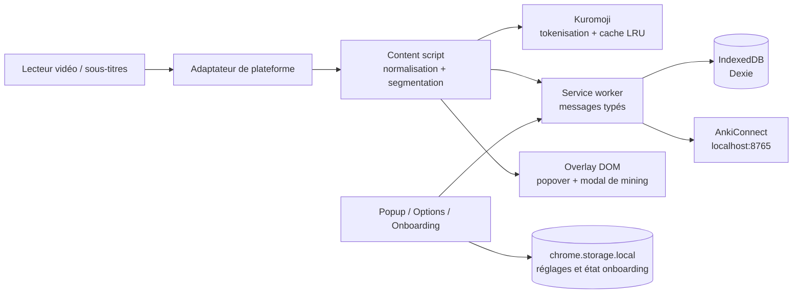

# Architecture de SubJap

## Vue d’ensemble

SubJap est une extension de navigateur Manifest V3 qui transforme les
sous-titres japonais d’un lecteur vidéo en support d’apprentissage :
détection des cues, tokenisation, affichage enrichi, consultation du
dictionnaire, marquage des mots connus et création de cartes de mining.

L’architecture sépare le traitement interactif, exécuté dans la page vidéo,
des opérations persistantes ou privilégiées, exécutées dans le service worker.
Les interfaces entre ces deux contextes sont centralisées dans
[`src/core/types.ts`](../src/core/types.ts) et [`src/core/messaging.ts`](../src/core/messaging.ts).

## Entrées et composants

Le manifeste est construit par Vite et `@crxjs/vite-plugin` à partir de
[`src/manifest.ts`](../src/manifest.ts). Il déclare :

- un service worker : [`src/background/service-worker.ts`](../src/background/service-worker.ts) ;
- un content script lancé à `document_end` sur les plateformes ciblées ;
- une popup React et une page Options React ;
- les fichiers de dictionnaire Kuromoji exposés depuis `public/dict/` ;
- les permissions de stockage, d’injection et les accès réseau nécessaires au
  téléchargement de JMdict et à AnkiConnect.

Les principaux modules sont organisés ainsi :

| Module | Responsabilité |
| --- | --- |
| `src/core/` | Types partagés, bus de messages, options et schéma Dexie. |
| `src/background/` | Persistance, lookups, statistiques, création de cartes, AnkiConnect et installation. |
| `src/content/` | Orchestration du pipeline dans la page vidéo et gestion des interactions. |
| `src/adapters/` | Adaptateurs de lecteurs ; Netflix est l’adaptateur réellement utilisé pour le MVP. |
| `src/tokenizer/` | Adaptateur Kuromoji, chargement des dictionnaires et cache LRU. |
| `src/subtitles/` | Normalisation, segmentation et parseurs SRT/VTT/ASS prêts pour l’import local. |
| `src/dictionary/` | Conversion JMdict et index de recherche ; le service worker interroge les entrées persistées. |
| `src/overlay/` | Rendu DOM vanilla des cues et popover de définition. |
| `src/mining/` | Modal de création de carte, TTS, capture d’image et client AnkiConnect. |
| `src/popup/`, `src/options/`, `src/onboarding/` | Surfaces UI et configuration initiale. |

## Sélection de plateforme et capture des sous-titres

Le content script enregistre les adaptateurs dans un
[`AdapterRegistry`](../src/core/adapters/registry.ts), puis sélectionne le
premier adaptateur dont `isActive()` correspond à la page. Chaque adaptateur
implémente le contrat `PlatformAdapter` : découverte de la vidéo, émission des
cues, temps courant, vitesse de lecture, contexte d’épisode et contrôle des
sous-titres natifs.

### Netflix

[`NetflixAdapter`](../src/adapters/netflix.ts) observe le DOM du lecteur :

1. `MutationObserver` repère le conteneur `.player-timedtext` et ses lignes ;
2. les mutations sont regroupées avec un debounce de 60 ms ;
3. les timestamps `data-start` / `data-end` sont utilisés lorsqu’ils existent,
   sinon le temps courant de la vidéo sert de repli ;
4. l’adaptateur réattache ses observateurs lorsqu’un lecteur est recréé par la
   navigation SPA ;
5. une voie `textTracks` est conservée comme fallback.

Le masquage des sous-titres natifs est piloté par une classe sur `<html>` et
une règle CSS document-level. Cette approche résiste à la recréation du DOM
Netflix et aux styles `visibility` inline de ses descendants. La préférence
est `hideNativeSubtitles`, activée par défaut.

### Adaptateur HTML5 générique

[`GenericHtml5Adapter`](../src/adapters/generic-html5.ts) sait lire les
`TextTrack` / `VTTCue` d’un élément `<video>` et contrôler leur visibilité.
Il constitue la base pour les lecteurs HTML5 standards et les futurs
adaptateurs. Le registre possède également un fallback ultime sans émission de
cues lorsque la page ne correspond à aucun adaptateur spécialisé. Dans le
content script actuel, Netflix est l’adaptateur explicitement enregistré ; le
branchement d’autres adaptateurs est une extension du registre.

## Pipeline de rendu

Le chemin principal est le suivant :

1. L’adaptateur émet un tableau de `SubtitleCue`.
2. [`normalizeCueText()`](../src/subtitles/normalize.ts) retire les balises
   HTML/ASS, décode les entités et normalise les espaces.
3. [`splitIntoSentences()`](../src/subtitles/segment.ts) sépare les phrases,
   respecte les retours à la ligne et limite les segments trop longs à 80
   caractères par défaut.
4. Le tokenizer Kuromoji est initialisé paresseusement. Son loader utilise
   `fetch()` + `DecompressionStream("gzip")`, avec timeout et erreurs
   explicites ; `kuromoji.builder()` n’est volontairement pas utilisé car son
   loader XHR peut rester bloqué dans un content script.
5. Chaque token est converti vers le type partagé `Token` : surface, lemme,
   lecture et parties du discours.
6. Les états de mots (`known` / `unknown`) sont demandés au service worker,
   avec déduplication des requêtes en vol.
7. Le content script récupère le nombre de mots connus et les rangs d’une
   liste de fréquence issue de sous-titres japonais. Le renderer construit des
   spans par token, ajoute éventuellement le furigana ; les mots connus restent
   blancs, les inconnus jusqu’au rang connu sont verts et les 300 rangs suivants
   sont bleus.

Le tokenizer est un singleton par content script et possède un cache LRU de
500 phrases. Les cues identiques sont ignorés grâce à une signature de texte.
Si Netflix remplace l’élément `<video>`, l’ancien overlay et le modal de mining
sont détruits puis recréés pour le nouveau lecteur.

## Overlay et interactions

[`OverlayRenderer`](../src/overlay/renderer.ts) est implémenté en DOM vanilla
pour éviter de faire passer le rendu de chaque token par React. Le conteneur :

- est monté directement sur `document.body` ;
- est en `position: fixed`, avec un z-index très élevé ;
- reprend les coordonnées de `video.getBoundingClientRect()` ;
- est repositionné périodiquement pour suivre resize, plein écran et contrôles
  du lecteur ;
- ancre les lignes en bas de la vidéo avec une marge inférieure pour éviter la
  barre de contrôle Netflix ;
- laisse les lignes interagir (`pointer-events: auto`) tout en laissant le
  conteneur global traversable.

Les événements sont délégués depuis le document :

- survol d’un token : ouverture de la popover après 350 ms ;
- sortie : fermeture après une grâce de 200 ms pour rejoindre la popover ;
- clic : popover épinglée jusqu’à `Escape` ou clic extérieur ;
- popover : définition, bascule connu/inconnu et accès au mining.

La recherche utilise `dict:lookup` vers le service worker. Celui-ci lit alors
JMdict depuis IndexedDB par headword, puis par reading. Le module
`src/dictionary/index.ts` fournit en parallèle un index mémoire headword /
reading, réutilisable lorsque le chargement en mémoire sera branché au flux.

## Service worker et persistance

Le service worker ouvre la base Dexie `SubJap` au démarrage. Les tables
actuelles sont :

- `wordStates` : état et provenance d’un lemme ;
- `mineCards` : cartes de phrases, métadonnées de l’épisode et état SRS ;
- `dictionaryEntries` : entrées JMdict converties ;
- `settings` : espace de réglages persistants côté IndexedDB.

Les handlers enregistrés dans le bus couvrent :

- `dict:status`, `dict:download` et `dict:lookup` ;
- `word:get`, `word:set` et `word:batch` ;
- `mine:create` et `stats:get` ;
- `data:reset` ;
- `anki:status`, `anki:syncKnown`, `anki:setup`, `anki:addNote` et
  `anki:dueCount` ;
- `tts:speak`, actuellement sans effet dans le service worker car
  `speechSynthesis` est utilisé dans les contextes foreground.

Les erreurs asynchrones des handlers sont encapsulées par le marqueur
`__subjapError` afin que `sendMessage()` rejette réellement la promesse au
lieu de renvoyer `undefined`.

### Format des messages et blobs

Le bus MV3 transporte des objets sérialisables. Les `Blob` ne traversent donc
pas directement `chrome.runtime.sendMessage` : le contrat de création de carte
prévoit des data URLs (`screenshotDataUrl`, `audioDataUrl`), puis le service
worker les reconvertit en `Blob` avant l’écriture IndexedDB. La capture
d’écran et l’extrait audio réel suivent ce chemin.

Les réglages légers sont séparés dans `chrome.storage.local`, sous la clé
`subjap_options`. [`DEFAULT_OPTIONS`](../src/core/options.ts) est la source
unique des valeurs par défaut et les changements sont appliqués en direct au
content script via `chrome.storage.onChanged`.

## Dictionnaire et installation

Le dictionnaire est JMdict-simplified, converti en `DictionaryEntry` par
[`src/dictionary/jmdict.ts`](../src/dictionary/jmdict.ts). Deux packs sont
proposés : un pack commun d’environ 22 000 entrées et un pack complet
d’environ 218 000 entrées.

Lors d’un téléchargement, le service worker :

1. récupère et décompresse l’archive gzip ;
2. convertit les mots JMdict ;
3. remplace les anciennes entrées IndexedDB par lots de 10 000 ;
4. marque le dictionnaire comme chargé dans `chrome.storage.local`.

Le téléchargement est donc réalisé hors de la page vidéo. Pendant la lecture,
la tokenisation et les lookups utilisent les ressources locales, sans appel à
une API de dictionnaire distante.

## Mining et AnkiConnect

Le mining est déclenché depuis la popover et ouvre
[`MiningModal`](../src/mining/modal.ts), qui présente la phrase, le token cible,
la lecture et les glosses sélectionnables. Le modal peut :

- générer l’audio du mot avec VOICEVOX local à partir de sa lecture ;
- découper l’audio réel du lecteur dans `AudioPhrase` quand le navigateur
  expose le flux audio ;
- capturer une image de la vidéo lorsque le navigateur l’autorise ;
- créer d’abord une carte locale dans IndexedDB ;
- pousser ensuite une copie vers AnkiConnect, en best effort.

La carte locale reste la source de vérité : une indisponibilité d’Anki ne fait
pas perdre le mining. Le modal conserve alors la carte locale, affiche l’erreur
et permet de réessayer sans créer de doublon local. Le service worker communique
avec AnkiConnect sur `127.0.0.1:8765`, crée automatiquement le deck `SubJap` et
garantit le type de note exact
`Migaku Memory` avec les champs `Mot`, `Lecture`, `Phrase`, `Traduction`,
`Définitions`, `Notes`, `Image`, `AudioMot` et `AudioPhrase`. Les médias sont
stockés par `storeMediaFile`, puis référencés dans les champs Migaku.

Les tags Anki `KNOWN`, `IGNORED`, `UNKNOWN` et `LEARNING` sont recherchés dans
tous les decks au démarrage, au retour sur l’onglet et périodiquement. Le champ
`Mot` est normalisé vers le lemme de `wordStates`, puis les imports sont
réconciliés : retirer un tag retire l’ancien état importé. Un état manuel local
reste prioritaire. `KNOWN` et `IGNORED` sont blancs, `LEARNING` violet,
`UNKNOWN` orange ; les mots sans état explicite suivent la fréquence (vert,
bleu, puis orange).

VOICEVOX est démarré localement par un Native Messaging host Windows enregistré
une seule fois ; voir [`docs/voicevox.md`](voicevox.md). Si la capture du flux
Netflix est bloquée par le navigateur ou le DRM, `AudioPhrase` reste vide et
la carte demeure valide.

## Interfaces utilisateur

- **Onboarding** : page Options ouverte au premier install ; trois étapes pour
  installer le dictionnaire, configurer ou ignorer AnkiConnect, puis enregistrer
  les réglages d’affichage.
- **Popup** : statut du dictionnaire, statistiques locales, statut Anki et
  rappel de l’onboarding.
- **Options** : installation ou réinstallation du pack JMdict, configuration
  du deck Anki, taille/police/furigana/couleur de l’overlay, masquage des
  sous-titres natifs, remise à zéro des données et relance de l’onboarding.

Les pages React ne contiennent pas la logique de lecture : elles utilisent le
bus de messages et les modules partagés pour lire ou modifier l’état.

## Contraintes et décisions importantes

- Le support Netflix dépend de sélecteurs DOM (`.player-timedtext`) susceptibles
  de changer ; les sélecteurs sont regroupés dans l’adaptateur.
- L’overlay ne doit pas être remonté dans le stacking context du player : cela
  rendrait le texte visible mais pourrait empêcher hover et clic.
- Il faut conserver le loader Kuromoji basé sur `fetch` et
  `DecompressionStream` avec timeout.
- Les options d’overlay doivent rester définies dans `src/core/options.ts`.
- Les données binaires doivent rester en data URLs sur le bus, puis être
  converties en `Blob` côté service worker.
- L’overlay reste visible pendant la pause : c’est le moment où l’apprenant
  peut lire la phrase.
- Le push Anki est volontairement best effort ; la carte locale est créée
  avant toute tentative réseau.

## État actuel et extensions prévues

Le MVP couvre le squelette MV3, Netflix, le pipeline de rendu, JMdict,
l’interaction hover/clic, le marquage connu/inconnu, le mining local, le push
Anki, le popup, les options et l’onboarding.

Les évolutions naturelles sont :

- alimenter l’accent tonal et ajouter les raccourcis clavier ;
- compléter les statistiques et l’historique ;
- ajouter un sélecteur de deck dans les Options ;
- brancher YouTube, Crunchyroll et Prime ;
- ajouter l’UI d’import SRT/ASS, l’export/import JSON et l’i18n FR/EN.

Les parseurs SRT/VTT/ASS sont déjà isolés dans `src/subtitles/`, mais leur
interface d’import n’est pas encore branchée au content script.
